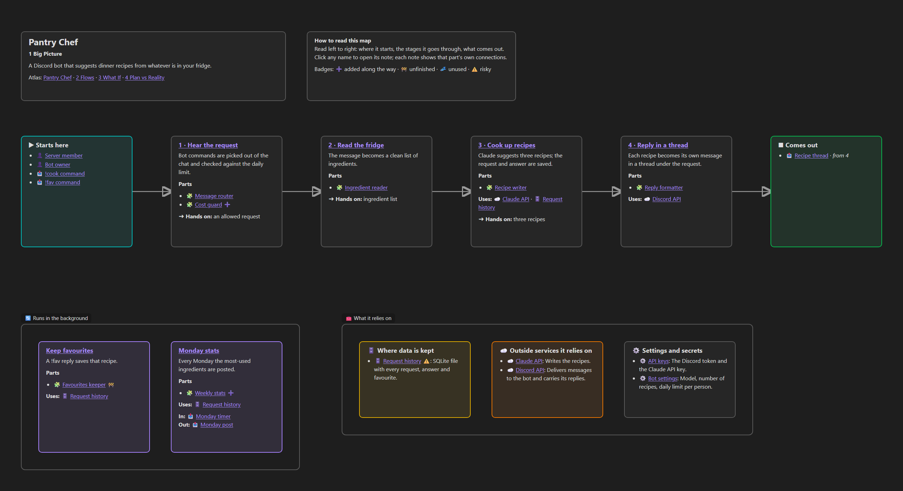
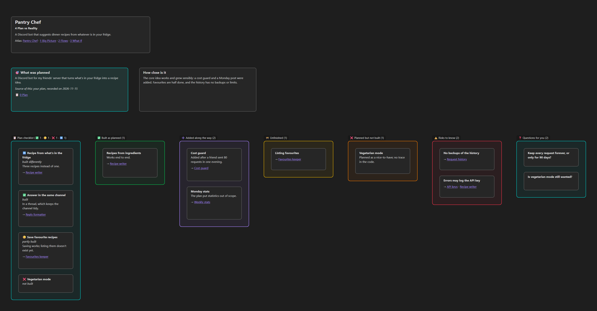

<h1 align="center">Project Atlas</h1>

<p align="center"><strong>See what you actually built.</strong></p>

<p align="center">
  A skill for Claude that reads a project, whether a vibe-coded app, a bot, an automation or a plan, and draws it as an <em>atlas</em> in Obsidian:<br>
  one calm page that tells the project's story, a zoom-in for every stage, what happens when things go wrong, how the result compares with what you planned, and how it drifts over time.
</p>

---

## Why

What you have in mind at the start of a project and what ends up in the folder are rarely the same. Features get added along the way, helper scripts appear, settings and secrets pile up, error paths are half-done, and nobody writes any of it down. After a long vibe-coding session the AI may have written most of the code, and you may never have read it.

Project Atlas reads the project **as it really is** and gives you a map you can actually look at. Record your plan at the start, and it also tells you exactly where the result drifted from it.

## See it

The Big Picture of a small example project (a Discord recipe bot): where it starts, four stages, what comes out, and what runs in the background.

<p align="center"></p>

Plan vs Reality, checked against the plan that was recorded before the first line of code:

<p align="center"></p>

More: [What If board](docs/images/what-if.png) · [a stage zoomed in](docs/images/stage.png) · [Flows](docs/images/flows.png).

**Try it without installing anything:** open the folder [`examples/obsidian-vault`](examples/obsidian-vault) in Obsidian (*Open folder as vault*) and start from `Project Atlas/Pantry Chef/Pantry Chef.md`.

## What you get

One folder in your Obsidian vault per project:

| Piece | Answers |
|---|---|
| **Home note** | What is this, in plain words? It opens with the project's story as a diagram. |
| **1 Big Picture** (canvas) | The whole project on one page, read left to right: where it starts, the 3–6 stages it goes through, what comes out, what it relies on. A handful of cards and arrows, not a wall of boxes. |
| **Stages** (canvases) | Click a stage on the Big Picture to zoom in: its parts, where things come from and where they go. |
| **2 Flows** (canvas) | What happens, step by step, when someone uses it. |
| **3 What If** (canvas) | A board from ❌ not handled to ✅ handled: a service is down, the input is bad, a key is missing, two things happen at once… with evidence from the code in each case's note. |
| **4 Plan vs Reality** (canvas + note) | A checklist against your recorded plan, then what was added along the way, what is unfinished, missing, left over or risky, and the questions only you can answer. |
| **0 Plan** (note) | Your plan, recorded at the start of the project, if you want one. |
| **Changes** (note) | What changed every time the atlas was refreshed: new parts, removed parts, what-ifs that got better or worse, plan items built. Drift, over time. |
| **One note per part** | Every input, part, store, service, flow and scenario gets a note with a small diagram of just its own connections. All notes link to each other, so Obsidian's **graph view** shows the project's real structure. |

The canvases are built to make a project feel simpler: overview first, detail on click. Every name on a canvas opens the note behind it. Write your own thoughts under **My notes** at the bottom of any note: they are kept when the atlas is refreshed.

## Install

**Claude Code, as a plugin** (recommended: adds the `/project-atlas:atlas` command and the refresh reminder)

```
claude plugin marketplace add AtaxanKitord/project-atlas
claude plugin install project-atlas@project-atlas
```

Or inside a session: `/plugin marketplace add AtaxanKitord/project-atlas`, then `/plugin` to install it.

**Claude Code, skill only**: copy the `skills/project-atlas` folder into `~/.claude/skills/`.

**Claude desktop app**: zip the `skills/project-atlas` folder and add it under *Settings → Capabilities → Skills*. The skill writes files into your vault, so use it where Claude can reach your files.

Requirements: Python 3.8 or newer (standard library only, nothing to `pip install`) and [Obsidian](https://obsidian.md) to view the result. Chrome, Edge or Chromium is used, when installed, to check the canvases as images and to make PNGs. No vault yet? Claude will offer a folder that you can open with *Open folder as vault*.

## Use

Ask in your own words, or use the command (`/project-atlas:atlas` with the plugin):

| You want to | Say | Command |
|---|---|---|
| Record what you're about to build | "I'm starting a bot that… record my plan." | `/project-atlas:atlas plan` |
| Map the project | "Map this project in Obsidian." / "What did we actually build?" | `/project-atlas:atlas` |
| Update it later | "Refresh the atlas, what changed?" | `/project-atlas:atlas refresh` |
| Show it to someone without Obsidian | "Make a version I can send to my client." | `/project-atlas:atlas share` |
| Check the canvases look right | "Check the atlas canvases." | `/project-atlas:atlas check` |

Claude finds your vaults, asks where to put the atlas if there's more than one, may ask you one question about what you originally set out to build, and then gives you a short tour of what it found. The atlas is written in the language you speak with Claude.

## How it works

1. **Survey.** `scan_project.py` lists the stack, entry points, environment variables, HTTP routes, schedules, n8n workflows, outside services, storage, error handling and loose ends. It only points at what to read.
2. **Read.** Claude reads the code and docs that matter, especially every place input enters and how each failure is handled, and takes the intent from your recorded plan (or asks you).
3. **Describe.** Claude writes one `atlas.json`: the parts, the stages that tell the project's story, links, flows, what-if scenarios and the plan-vs-reality comparison. Everything must trace back to the code, the docs or your own words; anything unverified is marked as unknown rather than guessed.
4. **Render.** `render_atlas.py` turns that file into notes and canvases (layout, colours, links with the right vault paths, Mermaid diagrams), keeps a snapshot in `history/` and writes the Changes note.
5. **Look.** `export_atlas.py --check` draws every canvas as an image with Obsidian's font size and reports cards whose text doesn't fit. Claude looks at the images and fixes what reads badly before handing the atlas over.

## Sharing

`export_atlas.py` (or `/project-atlas:atlas share`) writes one self-contained HTML file: every canvas with zoom and tabs, every note in a side panel. Optional PNG images of each canvas are handy for a README or a slide. Your "My notes" sections and the project's local folder path are left out unless you ask for them.

## Privacy

Everything runs on your machine. The scripts read your project and write only to the atlas folder and the export folder you choose; nothing is sent anywhere by them. Two small exceptions, both local:

- After rendering, the skill notes which folder holds each project's atlas in `~/.claude/project-atlas/registry.json` (or under `CLAUDE_CONFIG_DIR`). The plugin's reminder uses it at the start of a session: if the project changed since its atlas was refreshed, Claude may offer once to refresh it. Pass `--no-registry` to skip this.
- The shared HTML file loads the Mermaid library from jsdelivr to draw the diagrams inside notes, when the viewer is online.

## Repository layout

```
.claude-plugin/          plugin.json, marketplace.json
commands/atlas.md        the /project-atlas:atlas command
hooks/hooks.json         the session-start refresh reminder
examples/obsidian-vault/ a finished example atlas you can open in Obsidian
docs/images/             the pictures in this README
skills/project-atlas/
├── SKILL.md                    instructions Claude follows
├── references/atlas-format.md  the atlas.json format, with an example
└── scripts/
    ├── find_vaults.py          lists your Obsidian vaults and existing atlases
    ├── scan_project.py         read-only survey of a project folder
    ├── save_plan.py            records the plan at the start of a project
    ├── render_atlas.py         atlas.json → notes, canvases, history, Changes
    ├── export_atlas.py         --check images, or a shareable HTML/PNG export
    └── atlas_reminder.py       the reminder hook (prints nothing unless the atlas is out of date)
```

You can also use the scripts on their own: write an `atlas.json` by hand (see the format reference) and run

```
python skills/project-atlas/scripts/render_atlas.py atlas.json --out "<vault>/Project Atlas/<Project>"
```

## Feedback

Project Atlas is written and maintained by AtaXan. Ideas and bug reports are very welcome as [issues](https://github.com/AtaxanKitord/project-atlas/issues), especially:

- frameworks or platforms the scanner misses;
- canvases that come out hard to read on large projects;
- labels you translated for your language (paste them in the issue).

## License

[MIT](LICENSE) © 2026 AtaXan
