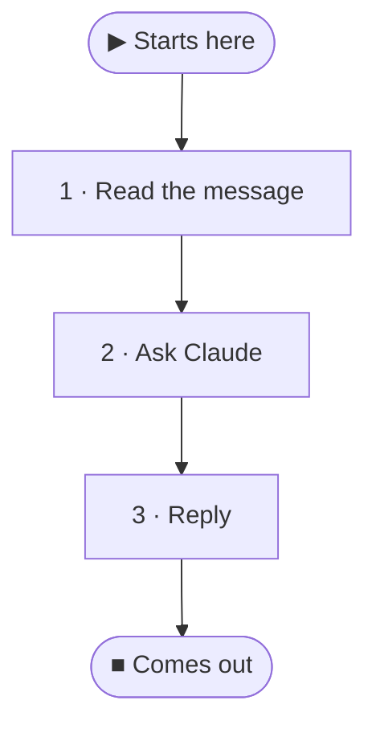

# Plan: Pantry Chef

> [!abstract] 📋 Recorded on 2026-11-15 06:07 · the owner, before the first line of code
> A Discord bot for my friends' server that turns what's in your fridge into a recipe idea.

**For whom:** About 40 friends on a private Discord server

## Must have
- Recipe from what's in the fridge
- Answer in the same channel
- Save favourite recipes

## Nice to have
- Vegetarian mode

## Out of scope
- Statistics
- Payments

## Done when
- A friend gets a recipe in under 10 seconds

## The story we expect

---
*This is the plan as it was recorded. When the project is mapped, Plan vs Reality checks every must-have against what was actually built. To change the plan, ask Claude to update it; the old version is kept in `history/`.*

## My notes
%% atlas:my-notes - anything below this line is kept when the atlas is regenerated %%
