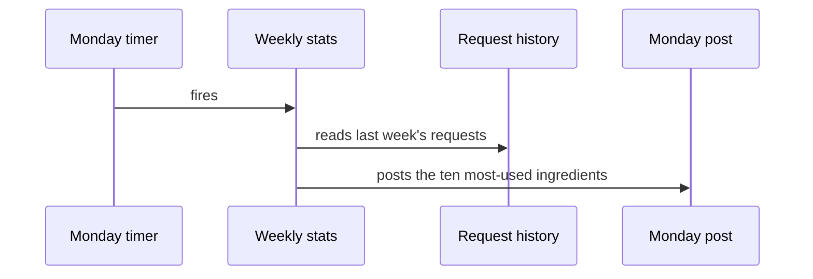

# Monday stats

> [!abstract] 🔁 Flow
> The weekly post nobody asked for, but everybody reads.

**Starts when:** Monday, 9:00

## Step by step
1. [[Project Atlas/Pantry Chef/Inputs/Monday timer|Monday timer]]: fires → [[Project Atlas/Pantry Chef/Parts/Weekly stats|Weekly stats]]
2. [[Project Atlas/Pantry Chef/Parts/Weekly stats|Weekly stats]]: reads last week's requests → [[Project Atlas/Pantry Chef/Storage/Request history|Request history]]
3. [[Project Atlas/Pantry Chef/Parts/Weekly stats|Weekly stats]]: posts the ten most-used ingredients → [[Project Atlas/Pantry Chef/Outputs/Monday post|Monday post]]

**Ends with:** A post in #kitchen

## Who talks to whom

---
Back to: [[Project Atlas/Pantry Chef/Pantry Chef|Pantry Chef]] · [[Project Atlas/Pantry Chef/1 Big Picture.canvas|1 Big Picture]] · [[Project Atlas/Pantry Chef/2 Flows.canvas|2 Flows]] · [[Project Atlas/Pantry Chef/3 What If.canvas|3 What If]] · [[Project Atlas/Pantry Chef/4 Plan vs Reality.canvas|4 Plan vs Reality]]

## My notes
%% atlas:my-notes - anything below this line is kept when the atlas is regenerated %%
