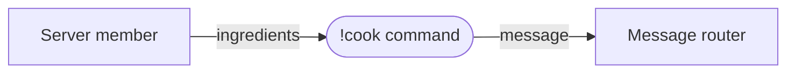

# !cook command

> [!info] 📥 Input
> A message starting with !cook and a list of ingredients.

## Connections
**Gets from**
- [[Project Atlas/Pantry Chef/People/Server member|Server member]]: ingredients

**Sends to**
- [[Project Atlas/Pantry Chef/Parts/Message router|Message router]]: message

## What can go wrong here
- ✅ [[Project Atlas/Pantry Chef/What If/What if someone sends !cook 200 times|What if someone sends !cook 200 times?]]
- ✅ [[Project Atlas/Pantry Chef/What If/What if someone pastes a whole shopping list of 300 items|What if someone pastes a whole shopping list of 300 items?]]

## Where it lives
- `src/bot.js:14`

---
Back to: [[Project Atlas/Pantry Chef/Pantry Chef|Pantry Chef]] · [[Project Atlas/Pantry Chef/1 Big Picture.canvas|1 Big Picture]] · [[Project Atlas/Pantry Chef/2 Flows.canvas|2 Flows]] · [[Project Atlas/Pantry Chef/3 What If.canvas|3 What If]] · [[Project Atlas/Pantry Chef/4 Plan vs Reality.canvas|4 Plan vs Reality]]

## My notes
%% atlas:my-notes - anything below this line is kept when the atlas is regenerated %%
