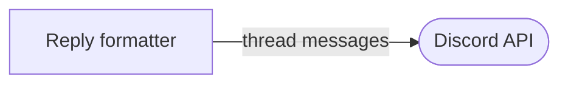

# Discord API

> [!warning] ☁️ Outside service
> Delivers messages to the bot and carries its replies.

## Connections
**Gets from**
- [[Project Atlas/Pantry Chef/Parts/Reply formatter|Reply formatter]]: thread messages

---
Back to: [[Project Atlas/Pantry Chef/Pantry Chef|Pantry Chef]] · [[Project Atlas/Pantry Chef/1 Big Picture.canvas|1 Big Picture]] · [[Project Atlas/Pantry Chef/2 Flows.canvas|2 Flows]] · [[Project Atlas/Pantry Chef/3 What If.canvas|3 What If]] · [[Project Atlas/Pantry Chef/4 Plan vs Reality.canvas|4 Plan vs Reality]]

## My notes
%% atlas:my-notes - anything below this line is kept when the atlas is regenerated %%
