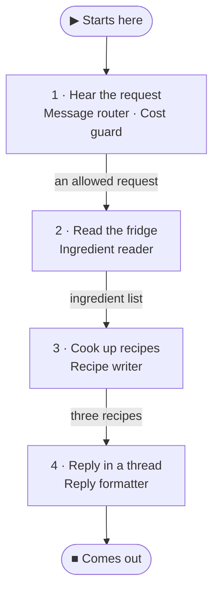

# Pantry Chef

> **A Discord bot that suggests dinner recipes from whatever is in your fridge.**

🗺️ **[[Project Atlas/Pantry Chef/1 Big Picture.canvas|Open the Big Picture]]**

Friends type `!cook` and list what is in their fridge. The bot asks Claude for three recipes that use those ingredients and answers in a thread under the message. People can save recipes they like with `!fav`, and every Monday the bot posts which ingredients were used most.

It is one Node.js process on a small VPS with a SQLite file next to it. This is a fictional example project, made to show what a project atlas looks like.

## Read this atlas
- 🗺️ [[Project Atlas/Pantry Chef/1 Big Picture.canvas|1 Big Picture]]: the whole project on one page, left to right
- 🔁 [[Project Atlas/Pantry Chef/2 Flows.canvas|2 Flows]]: step by step, what happens when it is used
- ⚡ [[Project Atlas/Pantry Chef/3 What If.canvas|3 What If]]: what happens when things go wrong
- 🎯 [[Project Atlas/Pantry Chef/4 Plan vs Reality.canvas|4 Plan vs Reality]] ([[Project Atlas/Pantry Chef/Plan vs Reality|Plan vs Reality]]): what was planned vs what is here now
- 📋 [[Project Atlas/Pantry Chef/0 Plan|0 Plan]]: what you set out to build, recorded on 2026-11-15
- 🕑 [[Project Atlas/Pantry Chef/Changes|Changes over time]]: what changed each time the atlas was refreshed

## At a glance

| | |
|---|---|
| 👤 People | 2 |
| 📥 Inputs | 3 |
| ⚙️ Settings | 2 |
| 🧩 Parts | 7 |
| 🗄️ Storage | 1 |
| ☁️ Outside Services | 2 |
| 📤 Outputs | 2 |
| 🔁 Flows | 3 |
| ⚡ What if… | 6 (❌ Not handled 2, ❔ Unknown, needs a check 1, ⚠️ Partly handled 1, ✅ Handled 2) |
| 📋 Plan | 1 of 4 built (✅ 1 · 🟡 1 · ❌ 1 · 🔀 1) |
| 🕑 Last change | [[Project Atlas/Pantry Chef/Changes|2026-11-15 06:07]]: ➕ 4 new, ✅ 1 what-if better |

**Who it is for:** A private Discord server of about 40 friends

**Built with:** Node.js 22 · discord.js · Claude API · SQLite

**Source:** `~/code/pantry-chef`

## How it works, stage by stage
- **[[Project Atlas/Pantry Chef/Stages/1 Hear the request.canvas|1 · Hear the request]]**: Bot commands are picked out of the chat and checked against the daily limit. ([[Project Atlas/Pantry Chef/Parts/Message router|Message router]], [[Project Atlas/Pantry Chef/Parts/Cost guard|Cost guard]])
- **[[Project Atlas/Pantry Chef/Stages/2 Read the fridge.canvas|2 · Read the fridge]]**: The message becomes a clean list of ingredients. ([[Project Atlas/Pantry Chef/Parts/Ingredient reader|Ingredient reader]])
- **[[Project Atlas/Pantry Chef/Stages/3 Cook up recipes.canvas|3 · Cook up recipes]]**: Claude suggests three recipes; the request and answer are saved. ([[Project Atlas/Pantry Chef/Parts/Recipe writer|Recipe writer]])
- **[[Project Atlas/Pantry Chef/Stages/4 Reply in a thread.canvas|4 · Reply in a thread]]**: Each recipe becomes its own message in a thread under the request. ([[Project Atlas/Pantry Chef/Parts/Reply formatter|Reply formatter]])

**🔄 In the background**
- **[[Project Atlas/Pantry Chef/Stages/Keep favourites.canvas|Keep favourites]]**: A !fav reply saves that recipe. ([[Project Atlas/Pantry Chef/Parts/Favourites keeper|Favourites keeper]])
- **[[Project Atlas/Pantry Chef/Stages/Monday stats.canvas|Monday stats]]**: Every Monday the most-used ingredients are posted. ([[Project Atlas/Pantry Chef/Parts/Weekly stats|Weekly stats]])

## 👤 People
- [[Project Atlas/Pantry Chef/People/Server member|Server member]]: Writes what is in their fridge and saves recipes they like.
- [[Project Atlas/Pantry Chef/People/Bot owner|Bot owner]]: Runs the VPS, sets the keys and reads the logs when something goes wrong.

## 📥 Inputs
- [[Project Atlas/Pantry Chef/Inputs/!cook command|!cook command]]: A message starting with !cook and a list of ingredients.
- [[Project Atlas/Pantry Chef/Inputs/!fav command|!fav command]]: A reply to one of the bot's recipes, saying 'keep this one'.
- [[Project Atlas/Pantry Chef/Inputs/Monday timer|Monday timer]]: Fires every Monday at 9:00.

## ⚙️ Settings
- [[Project Atlas/Pantry Chef/Settings/API keys|API keys]]: The Discord token and the Claude API key.
- [[Project Atlas/Pantry Chef/Settings/Bot settings|Bot settings]]: Model, number of recipes, daily limit per person.

## 🧩 Parts
- [[Project Atlas/Pantry Chef/Parts/Message router|Message router]]: Picks up bot commands and ignores everything else.
- [[Project Atlas/Pantry Chef/Parts/Ingredient reader|Ingredient reader]]: Turns a messy message into a clean list of ingredients.
- [[Project Atlas/Pantry Chef/Parts/Cost guard|Cost guard]]: Stops anyone from asking more than 20 times a day. *(➕ added along the way)*
- [[Project Atlas/Pantry Chef/Parts/Recipe writer|Recipe writer]]: Asks Claude for three recipes and checks the answer has the right shape.
- [[Project Atlas/Pantry Chef/Parts/Reply formatter|Reply formatter]]: Turns the recipes into a tidy Discord thread with one message per recipe.
- [[Project Atlas/Pantry Chef/Parts/Favourites keeper|Favourites keeper]]: Saves a recipe when someone replies !fav to it. *(🚧 unfinished)*
- [[Project Atlas/Pantry Chef/Parts/Weekly stats|Weekly stats]]: Counts last week's ingredients and posts the top ten. *(➕ added along the way)*

## 🗄️ Storage
- [[Project Atlas/Pantry Chef/Storage/Request history|Request history]]: SQLite file with every request, answer and favourite. *(⚠️ risky)*

## ☁️ Outside Services
- [[Project Atlas/Pantry Chef/Outside Services/Claude API|Claude API]]: Writes the recipes.
- [[Project Atlas/Pantry Chef/Outside Services/Discord API|Discord API]]: Delivers messages to the bot and carries its replies.

## 📤 Outputs
- [[Project Atlas/Pantry Chef/Outputs/Recipe thread|Recipe thread]]: Three recipes in a thread under the member's message.
- [[Project Atlas/Pantry Chef/Outputs/Monday post|Monday post]]: The week's ten most-used ingredients, posted in #kitchen.

## 🔁 Flows
- [[Project Atlas/Pantry Chef/Flows/Ask for a recipe|Ask for a recipe]]: The main journey, from a fridge list to three recipes.
- [[Project Atlas/Pantry Chef/Flows/Save a favourite|Save a favourite]]: Keeping a recipe for later.
- [[Project Atlas/Pantry Chef/Flows/Monday stats|Monday stats]]: The weekly post nobody asked for, but everybody reads.

## ⚡ What if…
- ❌ [[Project Atlas/Pantry Chef/What If/What if the request history grows for a year|What if the request history grows for a year?]]
- ❌ [[Project Atlas/Pantry Chef/What If/What if the bot restarts while writing a reply|What if the bot restarts while writing a reply?]]
- ❔ [[Project Atlas/Pantry Chef/What If/What if the API key ends up in the logs|What if the API key ends up in the logs?]]
- ⚠️ [[Project Atlas/Pantry Chef/What If/What if the Claude API is down|What if the Claude API is down?]]
- ✅ [[Project Atlas/Pantry Chef/What If/What if someone sends !cook 200 times|What if someone sends !cook 200 times?]]
- ✅ [[Project Atlas/Pantry Chef/What If/What if someone pastes a whole shopping list of 300 items|What if someone pastes a whole shopping list of 300 items?]]

## How to run it
`npm install`, copy `.env.example` to `.env` and fill in the two keys, then `npm start`.

## Glossary
[[Project Atlas/Pantry Chef/Glossary|Glossary]]

---
*Generated by project-atlas on 2026-11-15. Re-run it to refresh. Anything you write under “My notes” in any atlas note is kept.*

## My notes
%% atlas:my-notes - anything below this line is kept when the atlas is regenerated %%
