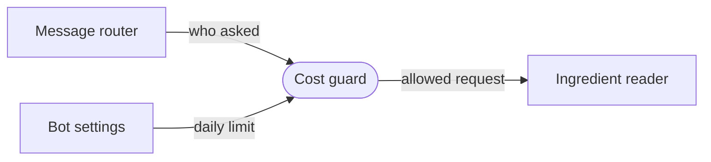

# Cost guard

> [!abstract] 🧩 Part · ➕ added along the way · Stage [[Project Atlas/Pantry Chef/Stages/1 Hear the request.canvas|1 · Hear the request]]
> Stops anyone from asking more than 20 times a day.

## Connections
**Gets from**
- [[Project Atlas/Pantry Chef/Parts/Message router|Message router]]: who asked
- [[Project Atlas/Pantry Chef/Settings/Bot settings|Bot settings]]: daily limit

**Sends to**
- [[Project Atlas/Pantry Chef/Parts/Ingredient reader|Ingredient reader]]: allowed request

## Part of these flows
- [[Project Atlas/Pantry Chef/Flows/Ask for a recipe|Ask for a recipe]], step 2: checks they have asked fewer than 20 times today

## What can go wrong here
- ✅ [[Project Atlas/Pantry Chef/What If/What if someone sends !cook 200 times|What if someone sends !cook 200 times?]]

## Where it lives
- `src/limits.js`

---
Back to: [[Project Atlas/Pantry Chef/Pantry Chef|Pantry Chef]] · [[Project Atlas/Pantry Chef/1 Big Picture.canvas|1 Big Picture]] · [[Project Atlas/Pantry Chef/2 Flows.canvas|2 Flows]] · [[Project Atlas/Pantry Chef/3 What If.canvas|3 What If]] · [[Project Atlas/Pantry Chef/4 Plan vs Reality.canvas|4 Plan vs Reality]]

## My notes
%% atlas:my-notes - anything below this line is kept when the atlas is regenerated %%
