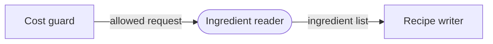

# Ingredient reader

> [!abstract] 🧩 Part · Stage [[Project Atlas/Pantry Chef/Stages/2 Read the fridge.canvas|2 · Read the fridge]]
> Turns a messy message into a clean list of ingredients.

## Connections
**Gets from**
- [[Project Atlas/Pantry Chef/Parts/Cost guard|Cost guard]]: allowed request

**Sends to**
- [[Project Atlas/Pantry Chef/Parts/Recipe writer|Recipe writer]]: ingredient list

## Part of these flows
- [[Project Atlas/Pantry Chef/Flows/Ask for a recipe|Ask for a recipe]], step 3: cleans the list and drops duplicates

## What can go wrong here
- ✅ [[Project Atlas/Pantry Chef/What If/What if someone pastes a whole shopping list of 300 items|What if someone pastes a whole shopping list of 300 items?]]

## Where it lives
- `src/parse.js`

---
Back to: [[Project Atlas/Pantry Chef/Pantry Chef|Pantry Chef]] · [[Project Atlas/Pantry Chef/1 Big Picture.canvas|1 Big Picture]] · [[Project Atlas/Pantry Chef/2 Flows.canvas|2 Flows]] · [[Project Atlas/Pantry Chef/3 What If.canvas|3 What If]] · [[Project Atlas/Pantry Chef/4 Plan vs Reality.canvas|4 Plan vs Reality]]

## My notes
%% atlas:my-notes - anything below this line is kept when the atlas is regenerated %%
