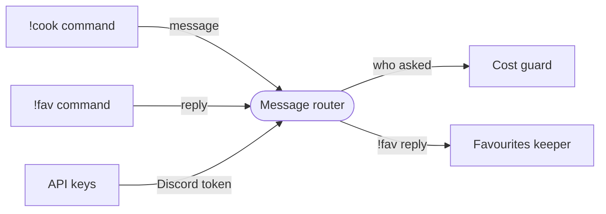

# Message router

> [!abstract] 🧩 Part · Stage [[Project Atlas/Pantry Chef/Stages/1 Hear the request.canvas|1 · Hear the request]]
> Picks up bot commands and ignores everything else.

## Connections
**Gets from**
- [[Project Atlas/Pantry Chef/Inputs/!cook command|!cook command]]: message
- [[Project Atlas/Pantry Chef/Inputs/!fav command|!fav command]]: reply
- [[Project Atlas/Pantry Chef/Settings/API keys|API keys]]: Discord token

**Sends to**
- [[Project Atlas/Pantry Chef/Parts/Cost guard|Cost guard]]: who asked
- [[Project Atlas/Pantry Chef/Parts/Favourites keeper|Favourites keeper]]: !fav reply

## Where it lives
- `src/bot.js`

---
Back to: [[Project Atlas/Pantry Chef/Pantry Chef|Pantry Chef]] · [[Project Atlas/Pantry Chef/1 Big Picture.canvas|1 Big Picture]] · [[Project Atlas/Pantry Chef/2 Flows.canvas|2 Flows]] · [[Project Atlas/Pantry Chef/3 What If.canvas|3 What If]] · [[Project Atlas/Pantry Chef/4 Plan vs Reality.canvas|4 Plan vs Reality]]

## My notes
%% atlas:my-notes - anything below this line is kept when the atlas is regenerated %%
