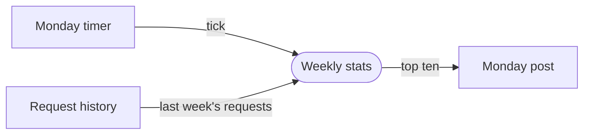

# Weekly stats

> [!abstract] 🧩 Part · ➕ added along the way · Stage [[Project Atlas/Pantry Chef/Stages/Monday stats.canvas|Monday stats]]
> Counts last week's ingredients and posts the top ten.

## Connections
**Gets from**
- [[Project Atlas/Pantry Chef/Inputs/Monday timer|Monday timer]]: tick
- [[Project Atlas/Pantry Chef/Storage/Request history|Request history]]: last week's requests

**Sends to**
- [[Project Atlas/Pantry Chef/Outputs/Monday post|Monday post]]: top ten

## Part of these flows
- [[Project Atlas/Pantry Chef/Flows/Monday stats|Monday stats]]
    - step 2: reads last week's requests
    - step 3: posts the ten most-used ingredients

## What can go wrong here
- ❌ [[Project Atlas/Pantry Chef/What If/What if the request history grows for a year|What if the request history grows for a year?]]

## Where it lives
- `src/stats.js`

---
Back to: [[Project Atlas/Pantry Chef/Pantry Chef|Pantry Chef]] · [[Project Atlas/Pantry Chef/1 Big Picture.canvas|1 Big Picture]] · [[Project Atlas/Pantry Chef/2 Flows.canvas|2 Flows]] · [[Project Atlas/Pantry Chef/3 What If.canvas|3 What If]] · [[Project Atlas/Pantry Chef/4 Plan vs Reality.canvas|4 Plan vs Reality]]

## My notes
%% atlas:my-notes - anything below this line is kept when the atlas is regenerated %%
