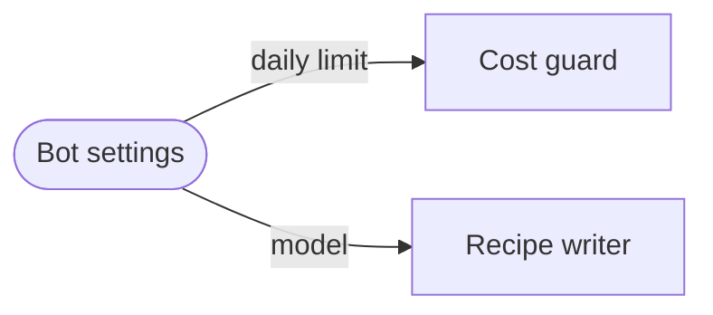

# Bot settings

> [!note] ⚙️ Setting
> Model, number of recipes, daily limit per person.

`MODEL`, `RECIPES_PER_REQUEST` (3), `DAILY_LIMIT` (20) in `.env`.

## Connections
**Sends to**
- [[Project Atlas/Pantry Chef/Parts/Cost guard|Cost guard]]: daily limit
- [[Project Atlas/Pantry Chef/Parts/Recipe writer|Recipe writer]]: model

---
Back to: [[Project Atlas/Pantry Chef/Pantry Chef|Pantry Chef]] · [[Project Atlas/Pantry Chef/1 Big Picture.canvas|1 Big Picture]] · [[Project Atlas/Pantry Chef/2 Flows.canvas|2 Flows]] · [[Project Atlas/Pantry Chef/3 What If.canvas|3 What If]] · [[Project Atlas/Pantry Chef/4 Plan vs Reality.canvas|4 Plan vs Reality]]

## My notes
%% atlas:my-notes - anything below this line is kept when the atlas is regenerated %%
