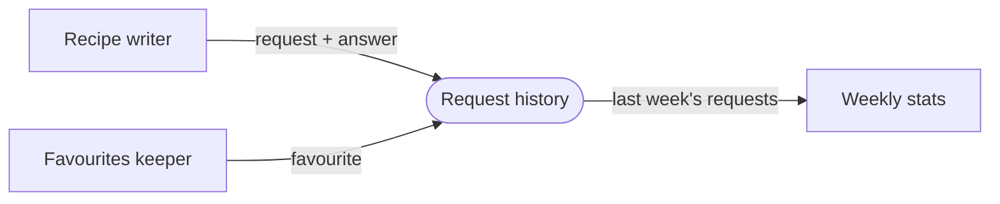

# Request history

> [!tip] 🗄️ Storage · ⚠️ risky
> SQLite file with every request, answer and favourite.

No backups and nothing is ever deleted.

## Connections
**Gets from**
- [[Project Atlas/Pantry Chef/Parts/Recipe writer|Recipe writer]]: request + answer
- [[Project Atlas/Pantry Chef/Parts/Favourites keeper|Favourites keeper]]: favourite

**Sends to**
- [[Project Atlas/Pantry Chef/Parts/Weekly stats|Weekly stats]]: last week's requests

## What can go wrong here
- ❌ [[Project Atlas/Pantry Chef/What If/What if the request history grows for a year|What if the request history grows for a year?]]

## Where it lives
- `data/pantry.db`

---
Back to: [[Project Atlas/Pantry Chef/Pantry Chef|Pantry Chef]] · [[Project Atlas/Pantry Chef/1 Big Picture.canvas|1 Big Picture]] · [[Project Atlas/Pantry Chef/2 Flows.canvas|2 Flows]] · [[Project Atlas/Pantry Chef/3 What If.canvas|3 What If]] · [[Project Atlas/Pantry Chef/4 Plan vs Reality.canvas|4 Plan vs Reality]]

## My notes
%% atlas:my-notes - anything below this line is kept when the atlas is regenerated %%
