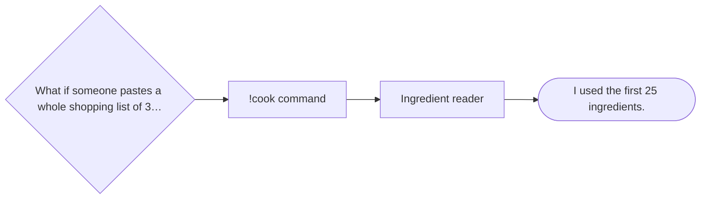

# What if someone pastes a whole shopping list of 300 items?

> [!success] ✅ Handled · low impact
> "I used the first 25 ingredients."

**Kind of problem:** bad input

## What happens
The reader keeps the first 25 ingredients and says so.

## What you would notice
"I used the first 25 ingredients."

## Is it handled?
✅ Handled

**Evidence:** `src/parse.js` MAX_INGREDIENTS = 25

## Parts involved
- [[Project Atlas/Pantry Chef/Inputs/!cook command|!cook command]]
- [[Project Atlas/Pantry Chef/Parts/Ingredient reader|Ingredient reader]]

---
Back to: [[Project Atlas/Pantry Chef/Pantry Chef|Pantry Chef]] · [[Project Atlas/Pantry Chef/1 Big Picture.canvas|1 Big Picture]] · [[Project Atlas/Pantry Chef/2 Flows.canvas|2 Flows]] · [[Project Atlas/Pantry Chef/3 What If.canvas|3 What If]] · [[Project Atlas/Pantry Chef/4 Plan vs Reality.canvas|4 Plan vs Reality]]

## My notes
%% atlas:my-notes - anything below this line is kept when the atlas is regenerated %%
