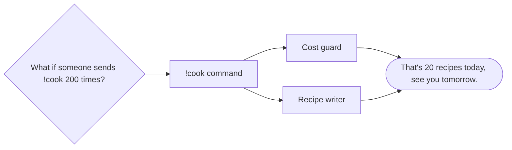

# What if someone sends !cook 200 times?

> [!success] ✅ Handled · high impact
> "That's 20 recipes today, see you tomorrow."

**Kind of problem:** cost

## What happens
The cost guard counts requests per person per day and refuses the 21st.

## What you would notice
"That's 20 recipes today, see you tomorrow."

## Is it handled?
✅ Handled

**Evidence:** `src/limits.js` DAILY_LIMIT check before the Claude call

## Parts involved
- [[Project Atlas/Pantry Chef/Inputs/!cook command|!cook command]]
- [[Project Atlas/Pantry Chef/Parts/Cost guard|Cost guard]]
- [[Project Atlas/Pantry Chef/Parts/Recipe writer|Recipe writer]]

## Flows
- [[Project Atlas/Pantry Chef/Flows/Ask for a recipe|Ask for a recipe]]

---
Back to: [[Project Atlas/Pantry Chef/Pantry Chef|Pantry Chef]] · [[Project Atlas/Pantry Chef/1 Big Picture.canvas|1 Big Picture]] · [[Project Atlas/Pantry Chef/2 Flows.canvas|2 Flows]] · [[Project Atlas/Pantry Chef/3 What If.canvas|3 What If]] · [[Project Atlas/Pantry Chef/4 Plan vs Reality.canvas|4 Plan vs Reality]]

## My notes
%% atlas:my-notes - anything below this line is kept when the atlas is regenerated %%
