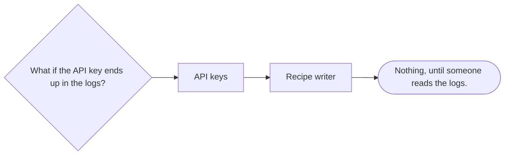

# What if the API key ends up in the logs?

> [!question] ❔ Unknown, needs a check · high impact
> Nothing, until someone reads the logs.

**Kind of problem:** settings

## What happens
Errors from the Claude call are logged as full objects, which may include request headers.

## What you would notice
Nothing, until someone reads the logs.

## Is it handled?
❔ Unknown, needs a check

**Evidence:** `src/chef.js:44` logs the whole error object; not checked whether it contains headers

## How to fix it
Log only `err.message`.

## Parts involved
- [[Project Atlas/Pantry Chef/Settings/API keys|API keys]]
- [[Project Atlas/Pantry Chef/Parts/Recipe writer|Recipe writer]]

---
Back to: [[Project Atlas/Pantry Chef/Pantry Chef|Pantry Chef]] · [[Project Atlas/Pantry Chef/1 Big Picture.canvas|1 Big Picture]] · [[Project Atlas/Pantry Chef/2 Flows.canvas|2 Flows]] · [[Project Atlas/Pantry Chef/3 What If.canvas|3 What If]] · [[Project Atlas/Pantry Chef/4 Plan vs Reality.canvas|4 Plan vs Reality]]

## My notes
%% atlas:my-notes - anything below this line is kept when the atlas is regenerated %%
