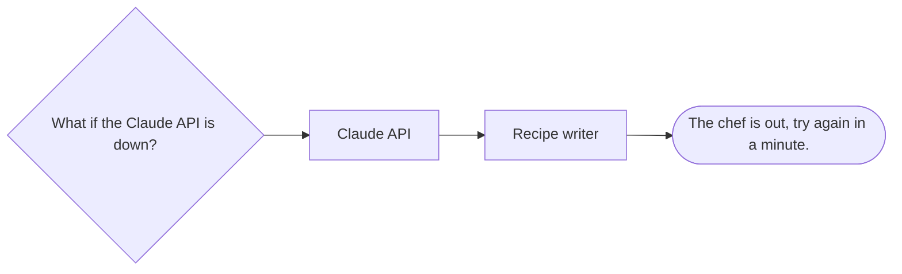

# What if the Claude API is down?

> [!warning] ⚠️ Partly handled · medium impact
> "The chef is out, try again in a minute."

**Kind of problem:** outside service

## What happens
The call throws; `chef.js` catches it and replies with a short apology. Nothing is retried.

## What you would notice
"The chef is out, try again in a minute."

## Is it handled?
⚠️ Partly handled

**Evidence:** `src/chef.js:41` try/catch around the API call

## How to fix it
Retry once after 5 seconds before apologising.

## Parts involved
- [[Project Atlas/Pantry Chef/Outside Services/Claude API|Claude API]]
- [[Project Atlas/Pantry Chef/Parts/Recipe writer|Recipe writer]]

## Flows
- [[Project Atlas/Pantry Chef/Flows/Ask for a recipe|Ask for a recipe]]

---
Back to: [[Project Atlas/Pantry Chef/Pantry Chef|Pantry Chef]] · [[Project Atlas/Pantry Chef/1 Big Picture.canvas|1 Big Picture]] · [[Project Atlas/Pantry Chef/2 Flows.canvas|2 Flows]] · [[Project Atlas/Pantry Chef/3 What If.canvas|3 What If]] · [[Project Atlas/Pantry Chef/4 Plan vs Reality.canvas|4 Plan vs Reality]]

## My notes
%% atlas:my-notes - anything below this line is kept when the atlas is regenerated %%
