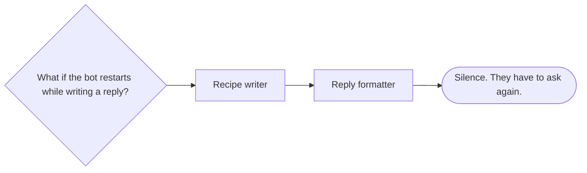

# What if the bot restarts while writing a reply?

> [!danger] ❌ Not handled · low impact
> Silence. They have to ask again.

**Kind of problem:** crash

## What happens
The request is lost: nothing is queued, so the member gets no answer and no error.

## What you would notice
Silence. They have to ask again.

## Is it handled?
❌ Not handled

**Evidence:** Requests are handled in memory only (`src/bot.js`)

## How to fix it
Reply "one moment…" first, and on start-up answer requests that have no reply in the history.

## Parts involved
- [[Project Atlas/Pantry Chef/Parts/Recipe writer|Recipe writer]]
- [[Project Atlas/Pantry Chef/Parts/Reply formatter|Reply formatter]]

---
Back to: [[Project Atlas/Pantry Chef/Pantry Chef|Pantry Chef]] · [[Project Atlas/Pantry Chef/1 Big Picture.canvas|1 Big Picture]] · [[Project Atlas/Pantry Chef/2 Flows.canvas|2 Flows]] · [[Project Atlas/Pantry Chef/3 What If.canvas|3 What If]] · [[Project Atlas/Pantry Chef/4 Plan vs Reality.canvas|4 Plan vs Reality]]

## My notes
%% atlas:my-notes - anything below this line is kept when the atlas is regenerated %%
