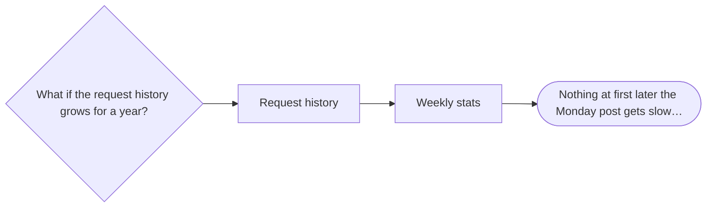

# What if the request history grows for a year?

> [!danger] ❌ Not handled · medium impact
> Nothing at first; later the Monday post gets slow and the disk fills up.

**Kind of problem:** growth

## What happens
Every answer is stored in full and nothing is deleted, so the file grows without limit and the Monday post scans all of it.

## What you would notice
Nothing at first; later the Monday post gets slow and the disk fills up.

## Is it handled?
❌ Not handled

**Evidence:** No delete or cleanup anywhere in `src/`

## How to fix it
Delete requests older than 90 days in the Monday job.

## Parts involved
- [[Project Atlas/Pantry Chef/Storage/Request history|Request history]]
- [[Project Atlas/Pantry Chef/Parts/Weekly stats|Weekly stats]]

---
Back to: [[Project Atlas/Pantry Chef/Pantry Chef|Pantry Chef]] · [[Project Atlas/Pantry Chef/1 Big Picture.canvas|1 Big Picture]] · [[Project Atlas/Pantry Chef/2 Flows.canvas|2 Flows]] · [[Project Atlas/Pantry Chef/3 What If.canvas|3 What If]] · [[Project Atlas/Pantry Chef/4 Plan vs Reality.canvas|4 Plan vs Reality]]

## My notes
%% atlas:my-notes - anything below this line is kept when the atlas is regenerated %%
