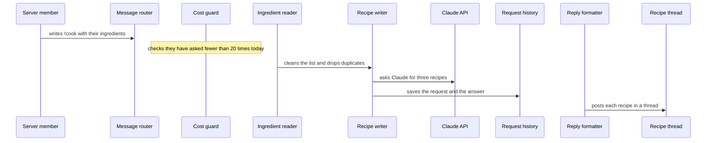

# Ask for a recipe

> [!abstract] 🔁 Flow
> The main journey, from a fridge list to three recipes.

**Starts when:** A member writes `!cook eggs, spinach, feta`

## Step by step
1. [[Pantry Chef/People/Server member|Server member]]: writes !cook with their ingredients → [[Pantry Chef/Parts/Message router|Message router]] *(message)*
2. [[Pantry Chef/Parts/Cost guard|Cost guard]]: checks they have asked fewer than 20 times today
3. [[Pantry Chef/Parts/Ingredient reader|Ingredient reader]]: cleans the list and drops duplicates → [[Pantry Chef/Parts/Recipe writer|Recipe writer]] *(ingredient list)*
4. [[Pantry Chef/Parts/Recipe writer|Recipe writer]]: asks Claude for three recipes → [[Pantry Chef/Outside Services/Claude API|Claude API]] *(prompt)*
5. [[Pantry Chef/Parts/Recipe writer|Recipe writer]]: saves the request and the answer → [[Pantry Chef/Storage/Request history|Request history]]
6. [[Pantry Chef/Parts/Reply formatter|Reply formatter]]: posts each recipe in a thread → [[Pantry Chef/Outputs/Recipe thread|Recipe thread]]

**Ends with:** Three recipes in a thread under the member's message

## Who talks to whom

## What can go wrong
- ⚠️ [[Pantry Chef/What If/What if the Claude API is down|What if the Claude API is down?]]
- ✅ [[Pantry Chef/What If/What if someone sends !cook 200 times|What if someone sends !cook 200 times?]]

---
Back to: [[Pantry Chef/Pantry Chef|Pantry Chef]] · [[Pantry Chef/1 Big Picture.canvas|1 Big Picture]] · [[Pantry Chef/2 Flows.canvas|2 Flows]] · [[Pantry Chef/3 What If.canvas|3 What If]] · [[Pantry Chef/4 Plan vs Reality.canvas|4 Plan vs Reality]]

## My notes
%% atlas:my-notes - anything below this line is kept when the atlas is regenerated %%
