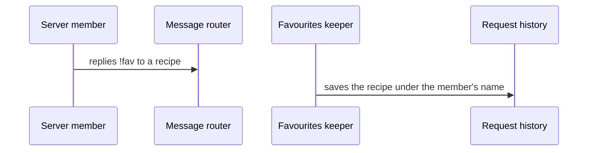

# Save a favourite

> [!abstract] 🔁 Flow
> Keeping a recipe for later.

**Starts when:** A member replies `!fav` to one of the bot's recipes

## Step by step
1. [[Pantry Chef/People/Server member|Server member]]: replies !fav to a recipe → [[Pantry Chef/Parts/Message router|Message router]]
2. [[Pantry Chef/Parts/Favourites keeper|Favourites keeper]]: saves the recipe under the member's name → [[Pantry Chef/Storage/Request history|Request history]] *(favourite)*

**Ends with:** The recipe is saved (there is no way to list favourites yet)

## Who talks to whom

---
Back to: [[Pantry Chef/Pantry Chef|Pantry Chef]] · [[Pantry Chef/1 Big Picture.canvas|1 Big Picture]] · [[Pantry Chef/2 Flows.canvas|2 Flows]] · [[Pantry Chef/3 What If.canvas|3 What If]] · [[Pantry Chef/4 Plan vs Reality.canvas|4 Plan vs Reality]]

## My notes
%% atlas:my-notes - anything below this line is kept when the atlas is regenerated %%
