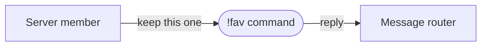

# !fav command

> [!info] 📥 Input
> A reply to one of the bot's recipes, saying 'keep this one'.

## Connections
**Gets from**
- [[Pantry Chef/People/Server member|Server member]]: keep this one

**Sends to**
- [[Pantry Chef/Parts/Message router|Message router]]: reply

## Where it lives
- `src/bot.js:31`

---
Back to: [[Pantry Chef/Pantry Chef|Pantry Chef]] · [[Pantry Chef/1 Big Picture.canvas|1 Big Picture]] · [[Pantry Chef/2 Flows.canvas|2 Flows]] · [[Pantry Chef/3 What If.canvas|3 What If]] · [[Pantry Chef/4 Plan vs Reality.canvas|4 Plan vs Reality]]

## My notes
%% atlas:my-notes - anything below this line is kept when the atlas is regenerated %%
