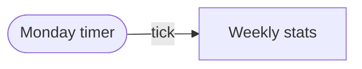

# Monday timer

> [!info] 📥 Input
> Fires every Monday at 9:00.

## Connections
**Sends to**
- [[Pantry Chef/Parts/Weekly stats|Weekly stats]]: tick

## Part of these flows
- [[Pantry Chef/Flows/Monday stats|Monday stats]], step 1: fires

## Where it lives
- `src/schedule.js`

---
Back to: [[Pantry Chef/Pantry Chef|Pantry Chef]] · [[Pantry Chef/1 Big Picture.canvas|1 Big Picture]] · [[Pantry Chef/2 Flows.canvas|2 Flows]] · [[Pantry Chef/3 What If.canvas|3 What If]] · [[Pantry Chef/4 Plan vs Reality.canvas|4 Plan vs Reality]]

## My notes
%% atlas:my-notes - anything below this line is kept when the atlas is regenerated %%
