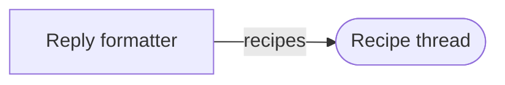

# Recipe thread

> [!success] 📤 Output
> Three recipes in a thread under the member's message.

## Connections
**Gets from**
- [[Pantry Chef/Parts/Reply formatter|Reply formatter]]: recipes

---
Back to: [[Pantry Chef/Pantry Chef|Pantry Chef]] · [[Pantry Chef/1 Big Picture.canvas|1 Big Picture]] · [[Pantry Chef/2 Flows.canvas|2 Flows]] · [[Pantry Chef/3 What If.canvas|3 What If]] · [[Pantry Chef/4 Plan vs Reality.canvas|4 Plan vs Reality]]

## My notes
%% atlas:my-notes - anything below this line is kept when the atlas is regenerated %%
