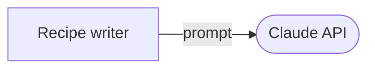

# Claude API

> [!warning] ☁️ Outside service
> Writes the recipes.

## Connections
**Gets from**
- [[Pantry Chef/Parts/Recipe writer|Recipe writer]]: prompt

## What can go wrong here
- ⚠️ [[Pantry Chef/What If/What if the Claude API is down|What if the Claude API is down?]]

---
Back to: [[Pantry Chef/Pantry Chef|Pantry Chef]] · [[Pantry Chef/1 Big Picture.canvas|1 Big Picture]] · [[Pantry Chef/2 Flows.canvas|2 Flows]] · [[Pantry Chef/3 What If.canvas|3 What If]] · [[Pantry Chef/4 Plan vs Reality.canvas|4 Plan vs Reality]]

## My notes
%% atlas:my-notes - anything below this line is kept when the atlas is regenerated %%
