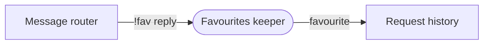

# Favourites keeper

> [!abstract] 🧩 Part · 🚧 unfinished · Stage [[Pantry Chef/Stages/Keep favourites.canvas|Keep favourites]]
> Saves a recipe when someone replies !fav to it.

Saving works; there is no command to list your favourites yet.

## Connections
**Gets from**
- [[Pantry Chef/Parts/Message router|Message router]]: !fav reply

**Sends to**
- [[Pantry Chef/Storage/Request history|Request history]]: favourite

## Part of these flows
- [[Pantry Chef/Flows/Save a favourite|Save a favourite]], step 2: saves the recipe under the member's name

## Where it lives
- `src/favs.js`

---
Back to: [[Pantry Chef/Pantry Chef|Pantry Chef]] · [[Pantry Chef/1 Big Picture.canvas|1 Big Picture]] · [[Pantry Chef/2 Flows.canvas|2 Flows]] · [[Pantry Chef/3 What If.canvas|3 What If]] · [[Pantry Chef/4 Plan vs Reality.canvas|4 Plan vs Reality]]

## My notes
%% atlas:my-notes - anything below this line is kept when the atlas is regenerated %%
