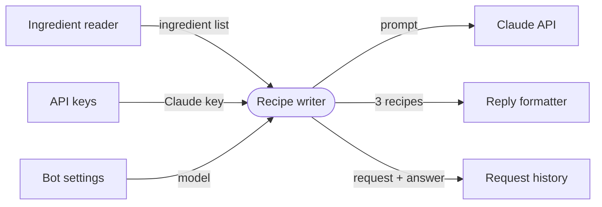

# Recipe writer

> [!abstract] 🧩 Part · Stage [[Pantry Chef/Stages/3 Cook up recipes.canvas|3 · Cook up recipes]]
> Asks Claude for three recipes and checks the answer has the right shape.

## Connections
**Gets from**
- [[Pantry Chef/Parts/Ingredient reader|Ingredient reader]]: ingredient list
- [[Pantry Chef/Settings/API keys|API keys]]: Claude key
- [[Pantry Chef/Settings/Bot settings|Bot settings]]: model

**Sends to**
- [[Pantry Chef/Outside Services/Claude API|Claude API]]: prompt
- [[Pantry Chef/Parts/Reply formatter|Reply formatter]]: 3 recipes
- [[Pantry Chef/Storage/Request history|Request history]]: request + answer

## Part of these flows
- [[Pantry Chef/Flows/Ask for a recipe|Ask for a recipe]]
    - step 4: asks Claude for three recipes
    - step 5: saves the request and the answer

## What can go wrong here
- ⚠️ [[Pantry Chef/What If/What if the Claude API is down|What if the Claude API is down?]]
- ✅ [[Pantry Chef/What If/What if someone sends !cook 200 times|What if someone sends !cook 200 times?]]
- ❌ [[Pantry Chef/What If/What if the bot restarts while writing a reply|What if the bot restarts while writing a reply?]]
- ❔ [[Pantry Chef/What If/What if the API key ends up in the logs|What if the API key ends up in the logs?]]

## Where it lives
- `src/chef.js`

---
Back to: [[Pantry Chef/Pantry Chef|Pantry Chef]] · [[Pantry Chef/1 Big Picture.canvas|1 Big Picture]] · [[Pantry Chef/2 Flows.canvas|2 Flows]] · [[Pantry Chef/3 What If.canvas|3 What If]] · [[Pantry Chef/4 Plan vs Reality.canvas|4 Plan vs Reality]]

## My notes
%% atlas:my-notes - anything below this line is kept when the atlas is regenerated %%
