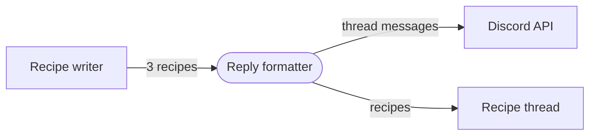

# Reply formatter

> [!abstract] 🧩 Part · Stage [[Pantry Chef/Stages/4 Reply in a thread.canvas|4 · Reply in a thread]]
> Turns the recipes into a tidy Discord thread with one message per recipe.

## Connections
**Gets from**
- [[Pantry Chef/Parts/Recipe writer|Recipe writer]]: 3 recipes

**Sends to**
- [[Pantry Chef/Outside Services/Discord API|Discord API]]: thread messages
- [[Pantry Chef/Outputs/Recipe thread|Recipe thread]]: recipes

## Part of these flows
- [[Pantry Chef/Flows/Ask for a recipe|Ask for a recipe]], step 6: posts each recipe in a thread

## What can go wrong here
- ❌ [[Pantry Chef/What If/What if the bot restarts while writing a reply|What if the bot restarts while writing a reply?]]

## Where it lives
- `src/format.js`

---
Back to: [[Pantry Chef/Pantry Chef|Pantry Chef]] · [[Pantry Chef/1 Big Picture.canvas|1 Big Picture]] · [[Pantry Chef/2 Flows.canvas|2 Flows]] · [[Pantry Chef/3 What If.canvas|3 What If]] · [[Pantry Chef/4 Plan vs Reality.canvas|4 Plan vs Reality]]

## My notes
%% atlas:my-notes - anything below this line is kept when the atlas is regenerated %%
