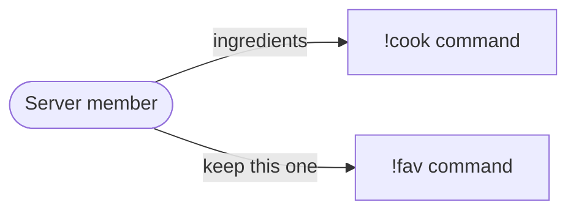

# Server member

> [!example] 👤 Person
> Writes what is in their fridge and saves recipes they like.

## Connections
**Sends to**
- [[Pantry Chef/Inputs/!cook command|!cook command]]: ingredients
- [[Pantry Chef/Inputs/!fav command|!fav command]]: keep this one

## Part of these flows
- [[Pantry Chef/Flows/Ask for a recipe|Ask for a recipe]], step 1: writes !cook with their ingredients
- [[Pantry Chef/Flows/Save a favourite|Save a favourite]], step 1: replies !fav to a recipe

---
Back to: [[Pantry Chef/Pantry Chef|Pantry Chef]] · [[Pantry Chef/1 Big Picture.canvas|1 Big Picture]] · [[Pantry Chef/2 Flows.canvas|2 Flows]] · [[Pantry Chef/3 What If.canvas|3 What If]] · [[Pantry Chef/4 Plan vs Reality.canvas|4 Plan vs Reality]]

## My notes
%% atlas:my-notes - anything below this line is kept when the atlas is regenerated %%
