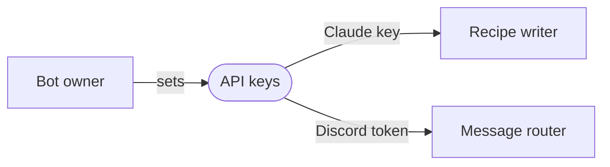

# API keys

> [!note] ⚙️ Setting
> The Discord token and the Claude API key.

`DISCORD_TOKEN`, `ANTHROPIC_API_KEY` in `.env`.

## Connections
**Gets from**
- [[Pantry Chef/People/Bot owner|Bot owner]]: sets

**Sends to**
- [[Pantry Chef/Parts/Recipe writer|Recipe writer]]: Claude key
- [[Pantry Chef/Parts/Message router|Message router]]: Discord token

## What can go wrong here
- ❔ [[Pantry Chef/What If/What if the API key ends up in the logs|What if the API key ends up in the logs?]]

---
Back to: [[Pantry Chef/Pantry Chef|Pantry Chef]] · [[Pantry Chef/1 Big Picture.canvas|1 Big Picture]] · [[Pantry Chef/2 Flows.canvas|2 Flows]] · [[Pantry Chef/3 What If.canvas|3 What If]] · [[Pantry Chef/4 Plan vs Reality.canvas|4 Plan vs Reality]]

## My notes
%% atlas:my-notes - anything below this line is kept when the atlas is regenerated %%
